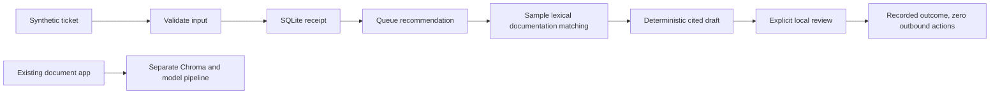

# AI Support Knowledge Base: architecture

The application separates Streamlit components from document loading, chunking, embedding/vector storage and conversational QA services. Chroma stores retrieved vectors; configured model providers supply application answers. The new offline sample uses Python standard-library SQLite, lexical matching and a deterministic template, and reuses the existing citation parser. It does not replace or prove the live model/vector pipeline.

- Keep the sample integration-free: no network client or sender exists, so even an approved sample cannot contact a customer or write to a CRM.
- Persist checkpoints and event IDs: restart can recover received or retryable work, while a reused ID with a different payload is rejected. The sample is a single-worker teaching example, not a distributed queue.
- Show supporting text and require explicit review: a draft is easy to inspect; lexical overlap and citation parsing alone do not validate semantic truth.

This diagram is a conceptual architecture visual, not a runtime screenshot.

