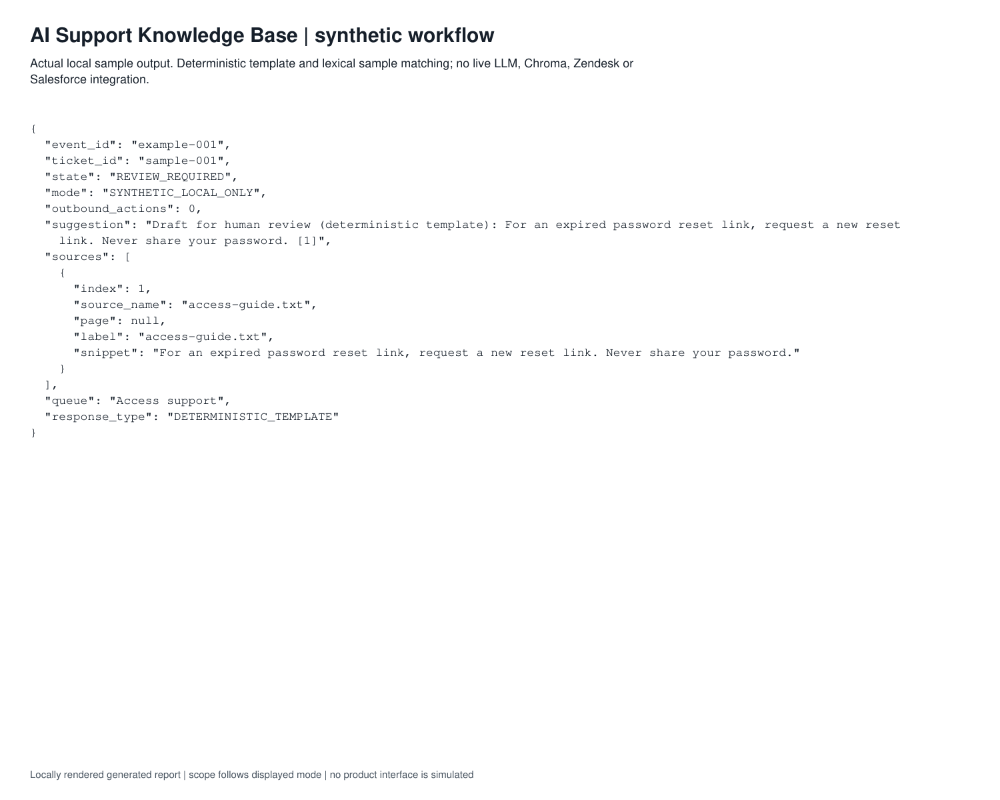
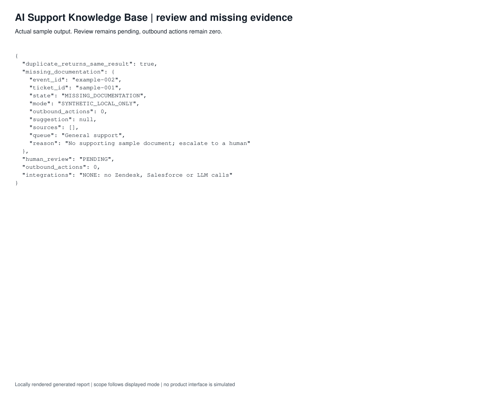
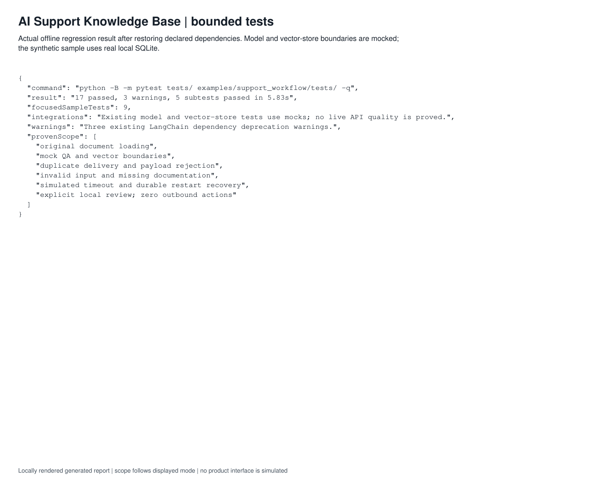

# Demonstrated scope

Nine focused unittest acceptance tests pass, covering success, duplicate delivery across restart, changed-payload rejection, missing evidence, invalid input, simulated timeout, interruption/recovery, approval boundaries and rejection. Storage recovery uses a real isolated SQLite database. The original app suite initially could not collect because dependencies were absent. After restoring its declared dependencies in an isolated local environment, the original tests and sample tests passed together: 17 tests and five unittest subtests, with three existing dependency deprecation warnings. No live model quality or CRM integration result is claimed.

The timeout and interruption are explicit simulations. This does not establish production Zendesk, Salesforce or LLM behavior. The sample does not support concurrent workers, SLAs, authenticated reviewer identity or a hosted backend. Existing citation mapping filters valid indexes but does not independently check every model claim.

## Capture labels

Locally rendered genuine output report; this is not an application UI screenshot. Read its scope and limitations below.

*Locally rendered genuine output report; this is not an application UI screenshot. Read its scope and limitations below.*

*Locally rendered genuine output report; this is not an application UI screenshot. Read its scope and limitations below.*

*Locally rendered genuine output report; this is not an application UI screenshot. Read its scope and limitations below.*

The figures are evidence for the described inputs and version only. No badge, production adoption or business-impact claim is inferred.

## Inspect complete reports

- [Complete support boundary report](../assets/support-boundary.pdf) · [JSON](./support-boundary.json)
- [Complete support overview report](../assets/support-overview.pdf) · [JSON](./support-overview.json)
- [Complete support tests report](../assets/support-tests.pdf) · [JSON](./support-tests.json)
